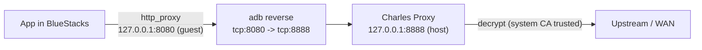

# Sniff SSL Traffic with BlueStacks 5 & Charles Proxy (ADB)

> Mobile app traffic interception lab guide — root the BlueStacks instance, push a
> system-level CA, route traffic through Charles, defeat certificate pinning, and
> post-process captured payloads.

> [!WARNING]
> **Historical archive.** This guide reflects an earlier BlueStacks / Android
> configuration. Since BlueStacks changed how its system partition and CA store are
> handled (and since Android moved the trusted store to the APEX path on newer
> versions), the legacy `/etc/security/cacerts` method below **no longer works
> out-of-the-box** on recent builds. It is kept as personal research / reference, not
> as a currently-working procedure. See
> [Environment & Android Version Caveats](#environment--android-version-caveats).

> [!NOTE]
> **Scope & authorization.** Only intercept apps you are authorized to test, inside a
> disposable lab instance. Do not commit private certificates, keys, or captured dumps.

---

## Index

1. [Overview & Traffic Flow](#overview--traffic-flow)
2. [Prerequisites](#prerequisites)
3. [Environment & Android Version Caveats](#environment--android-version-caveats)
4. [Step 1 — Gain Root Access](#step-1--gain-root-access)
5. [Step 2 — Set BlueStacks Disk as Read/Write](#step-2--set-bluestacks-disk-as-readwrite)
6. [Step 3 — ADB Utility (Android SDK)](#step-3--adb-utility-android-sdk)
7. [Step 4 — Remount BlueStacks Disk as Writable](#step-4--remount-bluestacks-disk-as-writable)
8. [Step 5 — Install Charles CA on the Windows Host](#step-5--install-charles-ca-on-the-windows-host)
9. [Step 6 — Export & Normalize the Charles Certificate](#step-6--export--normalize-the-charles-certificate)
10. [Step 7 — Push the Certificate to the System Store](#step-7--push-the-certificate-to-the-system-store)
11. [Step 8 — Charles SSL Proxying Settings](#step-8--charles-ssl-proxying-settings)
12. [Step 9 — Set Proxy & ADB Reverse Tunnel](#step-9--set-proxy--adb-reverse-tunnel)
13. [Sniff SSL Traffic](#sniff-ssl-traffic)
14. [Filtering Traffic with Rules](#filtering-traffic-with-rules)
15. [Attach an External / Upstream Proxy (Burp chaining)](#attach-an-external--upstream-proxy-burp-chaining)
16. [Defeating SSL Pinning (Frida / objection)](#defeating-ssl-pinning-frida--objection)
17. [Decode, Decompress & Python Scripting](#decode-decompress--python-scripting)
18. [Teardown & Reset](#teardown--reset)
19. [Boot-up Script](#boot-up-script)
20. [Troubleshooting](#troubleshooting)
21. [Considerations & Advice](#considerations--advice)

> [!NOTE]
> Throughout this document a BlueStacks instance is referred to as **BS**. Commands
> assume the default instance name `Pie64`; substitute your own instance name where
> relevant (Multi-Instance Manager → instance name).

---

## Overview & Traffic Flow

The objective is a transparent MITM position on TLS traffic generated by apps running
inside BS. Because `127.0.0.1` **inside** the Android guest is the guest itself (not the
Windows host), traffic is tunneled back to the host-side proxy with `adb reverse`
rather than pointing the guest at the host LAN IP.

Quick-glance flow (renders on GitHub):



Detailed view:

```
┌─────────────────────────── BlueStacks guest (Android) ───────────────────────────┐
│                                                                                   │
│   App  ──TLS──►  global http_proxy = 127.0.0.1:8080                               │
│                              │                                                    │
└──────────────────────────────┼───────────────────────────────────────────────────┘
                               │  adb reverse tcp:8080 -> tcp:8888
                               ▼
┌─────────────────────────────── Windows host ─────────────────────────────────────┐
│   Charles Proxy  (listen 127.0.0.1:8888)  ──► decrypt (system CA trusted) ──► WAN │
└───────────────────────────────────────────────────────────────────────────────────┘
```

Two distinct certificate installs are required, and they serve **different** purposes:

| Install | Target store | Purpose |
|---|---|---|
| Step 5 | Windows *Trusted Root CA* | So the **host** OS / Charles itself trust the CA (host-side tooling, browsers). |
| Step 7 | Android `/etc/security/cacerts` | So **apps inside BS** trust Charles' leaf certs. This is the one that actually enables decryption of guest traffic. |

> [!IMPORTANT]
> Since Android 7 (Nougat), apps do **not** trust user-added CAs by default — only the
> *system* CA store is trusted app-wide. That is why Step 7 pushes the cert into
> `/etc/security/cacerts` instead of using the Android *Settings → Install certificate*
> UI. Apps using certificate pinning will still reject the cert: see
> [Defeating SSL Pinning](#defeating-ssl-pinning-frida--objection).

---

## Prerequisites

| Component | Source | Notes |
|---|---|---|
| BlueStacks 5 | <https://www.bluestacks.com/download.html> | Use a 64-bit instance; note its name. |
| Charles Proxy | <https://www.charlesproxy.com/> | 30-day trial, then ~50 USD license. |
| Android platform-tools (ADB) | <https://developer.android.com/tools/releases/platform-tools> | Provides `adb`. Add `platform-tools` to `PATH`. |
| OpenSSL | WSL / Git Bash / standalone | For `subject_hash_old`. |
| Frida + objection *(optional)* | `pip install frida-tools objection` | Required only for pinned apps. |

---

## Environment & Android Version Caveats

The system-CA method below targets the legacy cert store path `/etc/security/cacerts`,
which is writable on **Android 9–11** instances (BlueStacks `Pie64`, `Nougat`, `Android 11`).

| BS Android version | Cert store behaviour | Action |
|---|---|---|
| 7 / 9 / 11 | `/etc/security/cacerts` writable after remount | Standard flow (this guide). |
| 13+ (rare on BS) | cacerts moved to APEX `/apex/com.android.conscrypt/cacerts` | Requires APEX bind-mount or a Magisk module; the legacy path is no longer authoritative. |

> [!TIP]
> Pick a **Pie64 / Android 11** instance for the least friction. Verify with
> `adb -s 127.0.0.1:5555 shell getprop ro.build.version.release`.

> [!NOTE]
> BS instances run on **x86_64**, not ARM. This matters when downloading
> `frida-server` (use the `android-x86_64` build) and ARM-only APKs may fail to launch.

---

## Step 1 — Gain Root Access

Root is required to remount the system partition and write into the CA store.

**Where:** on the Windows host (editing a config file), BS off is not required for the
edit but restart BS afterwards.

1. Open the BlueStacks install dir (default `C:\ProgramData\BlueStacks_nxt`), then open
   `..\BlueStacks_nxt\bluestacks.conf` in a text editor (Notepad, Notepad++…).
2. Locate the following keys, which default to `"0"`:

   ```ini
   bst.feature.rooting="0"
   bst.instance.Pie64.enable_root_access="0"
   ```

3. Set **both** to `"1"`:

   ```ini
   bst.feature.rooting="1"
   bst.instance.Pie64.enable_root_access="1"
   ```

4. Restart BlueStacks.

> [!NOTE]
> `Pie64` is the default instance name. If you run multiple instances, match the exact
> name from the Multi-Instance Manager and ensure **both** keys are set to `1`.

> [!TIP]
> Install a "Root Checker" app from the Play Store to confirm root was granted.
> Reference walkthrough: <https://youtu.be/EVk5vq_0vkE>

---

## Step 2 — Set BlueStacks Disk as Read/Write

The virtual disk must be `Normal` (not `Readonly`) so files can be persisted into BS.
This sets the disk type offline; the live partition remount happens later in Step 4.

**Where:** Windows host, with **all BS instances closed**.

1. Navigate to `..\BlueStacks_nxt\Engine\Pie64`.
2. **Shut down all BS instances completely** before editing (check the tray / Task Manager).
3. Edit `<InstanceName>.bstk` (e.g. `Pie64.bstk`) and change each disk `type` from
   `Readonly` to `Normal`:

   ```diff
     <HardDisk uuid="{20131fc8-...}" location="fastboot.vdi" format="VDI"  type="Normal"/>
   - <HardDisk uuid="{8e0166f0-...}" location="Root.vhd"     format="VHD"  type="Readonly"/>
   + <HardDisk uuid="{8e0166f0-...}" location="Root.vhd"     format="VHD"  type="Normal"/>
   - <HardDisk uuid="{52439b89-...}" location="Data.vhdx"    format="VHDX" type="Readonly"/>
   + <HardDisk uuid="{52439b89-...}" location="Data.vhdx"    format="VHDX" type="Normal"/>
   ```

4. Start the BS instance.

> [!CAUTION]
> If any instance is still running when you save the `.bstk`, BlueStacks will overwrite
> your changes on shutdown. Confirm everything is closed before editing.

---

## Step 3 — ADB Utility (Android SDK)

ADB bridges Windows and the BS guest: shell access, file push/pull, port forwarding.

### Add ADB to PATH (Windows host)

1. Extract `platform-tools.zip` (e.g. `C:\platform-tools`).
2. Start menu → *Edit the system environment variables* → **Environment Variables…**
3. *System variables* → select **Path** → **Edit…** → **New** → add `C:\platform-tools`.
4. Open a **new** PowerShell session and run `adb version` to confirm (existing shells
   won't have the updated PATH).

### Enable ADB in BlueStacks (guest/BS setting)

- BS Settings → **Advanced** → enable **Android Debug Bridge (ADB)**. A loopback
  endpoint appears, e.g. `127.0.0.1:5555`.

### Connect (Windows host)

```bash
adb connect 127.0.0.1:5555
adb -s 127.0.0.1:5555 shell
# inside the guest shell:
su          # elevate
whoami      # -> root
```

Expected: `whoami` returns `root`.

---

## Step 4 — Remount BlueStacks Disk as Writable

**Where:** inside the root ADB shell (guest).

Checklist before continuing:

- [x] BS disk set to `Normal` (Step 2)
- [x] Root access granted (Step 1)
- [x] Active ADB shell as root (Step 3)

```bash
mount -o remount,rw rootfs /
mount -o remount,rw /dev/sda1 /system
```

No output = success.

> [!NOTE]
> **`/dev/sda1` is not guaranteed.** The block device backing `/system` varies by
> instance and BS version, so the second command may fail as written
> (`mount: '/dev/sda1' not found` or `Invalid argument`). Before running it, look up the
> actual device and use that name instead:
>
> ```bash
> mount | grep system          # or: cat /proc/mounts | grep system
> # e.g. if it reports /dev/block/sda6 on /system, run:
> # mount -o remount,rw /dev/block/sda6 /system
> ```

---

## Step 5 — Install Charles CA on the Windows Host

This makes the **host** trust the Charles root CA (needed for host-side tooling and to
silence Charles' own warnings). It does **not** by itself make BS apps trust Charles.

**Where:** Charles on the Windows host.

1. Charles → `Help → SSL Proxying → Install Charles Root Certificate`
2. **Install Certificate…**
3. Store location: **Local Machine**
4. **Place all certificates in the following store**
5. Select **Trusted Root Certification Authorities** → Finish.

---

## Step 6 — Export & Normalize the Charles Certificate

Android's system store expects a file named `<subject_hash_old>.0`.

**Where:** Charles (export) + a shell with OpenSSL (WSL / Git Bash / standalone) on the host.

1. Charles → `Help → SSL Proxying → Save Charles Root Certificate` → save as PEM
   (e.g. `charles.pem` on the Desktop).
2. Compute the Android-style hash:

   ```bash
   openssl x509 -in charles.pem -subject_hash_old -noout
   # example output: 9a5ba575
   ```

3. Rename the PEM to `<hash>.0`:

   ```bash
   # Linux / WSL / Git Bash
   mv charles.pem 9a5ba575.0
   ```

   ```powershell
   # Windows
   rename charles.pem 9a5ba575.0
   ```

> [!TIP]
> Use WSL, Git Bash, or a standalone OpenSSL build. `subject_hash_old` produces the
> legacy MD5-based hash that the Android cacerts directory keys on — do **not** use the
> newer `subject_hash`.

---

## Step 7 — Push the Certificate to the System Store

From the folder containing the renamed cert, open PowerShell (Shift + Right-click).

**Where:** `push` from the Windows host; `mv` / `chown` / `chmod` from the root ADB shell (guest).

```powershell
# 1. Push to a staging dir inside the guest (host PowerShell)
adb -s 127.0.0.1:5555 push ./9a5ba575.0 /data/local/tmp/

# 2. Open the guest shell and elevate
adb -s 127.0.0.1:5555 shell
su

# 3. Move into the system CA store (inside the guest shell)
mv /data/local/tmp/9a5ba575.0 /etc/security/cacerts/

# 4. Fix ownership and permissions
chown system:system /etc/security/cacerts/9a5ba575.0
chmod 644          /etc/security/cacerts/9a5ba575.0
```

Verify the cert is now part of the system trust store, then reboot the guest so apps
reload the store:

```bash
ls -l /etc/security/cacerts/ | grep 9a5ba575
exit; exit
adb -s 127.0.0.1:5555 reboot     # or restart the instance from the BS UI
```

> [!IMPORTANT]
> Skipping `chmod 644` / `chown system:system` is the most common reason a correctly
> pushed cert is ignored — the system silently refuses certs with wrong perms.

> [!NOTE]
> On some Android builds the authoritative path is `/system/etc/security/cacerts`. Use
> the path exposed by your BS image.

---

## Step 8 — Charles SSL Proxying Settings

By default Charles only tunnels HTTPS (you see opaque `CONNECT` entries, no payloads).
You must whitelist hosts for SSL decryption.

**Where:** Charles on the host.

1. Charles → `Proxy → SSL Proxying Settings → SSL Proxying` tab.
2. **Enable SSL Proxying**.
3. **Add** a location. For broad capture use:

   | Host | Port |
   |---|---|
   | `*` | `443` |

4. Narrow it down later to specific targets (e.g. `api.target.com : 443`) to cut noise.

> [!TIP]
> Confirm Charles' own listen port: `Proxy → Proxy Settings → HTTP Proxy → Port`.
> This guide assumes **8888** (Charles default). If you changed it, adjust the
> `adb reverse` target in Step 9 accordingly.

---

## Step 9 — Set Proxy & ADB Reverse Tunnel

Point the Android system proxy at the guest loopback, then tunnel that loopback port
back to Charles on the host.

**Where:** Windows host (both commands target the guest via ADB).

```bash
# Android system proxy -> guest loopback :8080
adb -s 127.0.0.1:5555 shell settings put global http_proxy 127.0.0.1:8080

# tunnel guest :8080 -> host :8888 (Charles)
adb -s 127.0.0.1:5555 reverse tcp:8080 tcp:8888
```

**Port map**

| Endpoint | Role |
|---|---|
| `127.0.0.1:5555` | BS ADB control channel (host ↔ guest). |
| `127.0.0.1:8080` | Android-side proxy address (inside the guest). |
| `127.0.0.1:8888` | Charles listen port (on the Windows host). |

**Flow:** `App → guest 127.0.0.1:8080 → adb reverse → host 127.0.0.1:8888 (Charles) → WAN`

> [!NOTE]
> `adb reverse` is preferred over `adb forward` here: it exposes a host port *inside*
> the guest as a guest-local port, so the Android proxy can stay on `127.0.0.1` and you
> avoid host-LAN-IP / NAT issues.

---

## Sniff SSL Traffic

With the proxy and tunnel up and the system CA trusted, generate traffic from any app
in BS. In Charles you should now see decrypted requests under the target hosts.

Sanity checks if nothing decrypts:

1. **Tunnel alive?** `adb -s 127.0.0.1:5555 reverse --list` should show `tcp:8080 tcp:8888`.
2. **Proxy set?** `adb -s 127.0.0.1:5555 shell settings get global http_proxy` → `127.0.0.1:8080`.
3. **SSL Proxying location matches the host?** (Step 8 — `*:443` or specific host).
4. **CONNECT only, no body?** → host not whitelisted in SSL Proxying, or the app pins
   (go to [pinning](#defeating-ssl-pinning-frida--objection)).
5. **Connection reset / no traffic at all?** → cert perms wrong, or guest not rebooted
   after Step 7.

> [!NOTE]
> Decryption only works if you capture the TLS handshake, established at the start of
> the first request. If you miss it, re-establish the connection (e.g. restart the app
> inside BS) so a fresh handshake is captured.

> [!TIP]
> `Proxy → Recording Settings` lets you cap recording to specific hosts so the session
> stays manageable.

---

## Filtering Traffic with Rules

High-noise sessions (telemetry, ads, analytics) drown the signal. Layer these filters:

| Mechanism | Where | Use |
|---|---|---|
| **Focus** | Right-click host → *Focus* | Greys out everything else without dropping it. |
| **Filter bar** | Bottom of the main window | Live substring filter on URL. |
| **SSL Proxying locations** | `Proxy → SSL Proxying Settings` | Only decrypt the hosts you care about. |
| **Recording rules** | `Proxy → Recording Settings → Include/Exclude` | Drop hosts from capture entirely. |
| **Block List** | `Tools → Block List` | Return 403/reset for ad/telemetry domains. |
| **Map Remote / Map Local** | `Tools → Map …` | Redirect or stub responses for testing. |

**Recommended include filter** (Recording Settings → Include):

```
Protocol: https   Host: *.target.com   Port: 443
```

> [!TIP]
> Combine *Focus* (visual) + *Recording Include* (data) to keep both the UI and the
> exported session lean.

---

## Attach an External / Upstream Proxy (Burp chaining)

Two patterns, depending on which tool you want as the active interceptor.

### Pattern A — Charles capture, Burp upstream

Keep Charles as the guest-facing proxy and chain it to Burp for Repeater/Intruder.

1. Burp → `Proxy → Options` → add listener on `127.0.0.1:8081`, *Invisible* off.
2. Charles → `Proxy → External Proxy Settings`:

   | Field | Value |
   |---|---|
   | Use external proxy | ✔ |
   | HTTP/HTTPS proxy host | `127.0.0.1` |
   | Port | `8081` |

3. Install **Burp's** CA into BS as well (repeat Steps 6–7 with Burp's DER/PEM export)
   so the inner hop also validates.

### Pattern B — Burp directly (recommended for a Burp-centric workflow)

Skip Charles entirely; point the guest at Burp.

```bash
# Burp listening on 127.0.0.1:8080 (Proxy listener)
adb -s 127.0.0.1:5555 shell settings put global http_proxy 127.0.0.1:8080
adb -s 127.0.0.1:5555 reverse tcp:8080 tcp:8080
```

Then push Burp's CA (`Proxy → Proxy settings → Import/export CA cert → DER`, convert to
PEM, hash-rename per Step 6) into the system store.

### Tool selection

| Tool | Strength | When to pick |
|---|---|---|
| **Charles** | Fast triage, clean UI, easy SSL config, gzip/brotli auto-decode | Recon, quick capture, repro. |
| **Burp** | Repeater/Intruder/Scanner, extensions, scripting | Active testing, fuzzing, injection. |
| **mitmproxy** | Python addons, fully scriptable, headless | Automation, CI, bulk transforms. |

---

## Defeating SSL Pinning (Frida / objection)

A system-trusted CA is **not** enough for apps that pin certificates (the app rejects
any cert not matching a hard-coded pin/SPKI). Bypass at runtime with Frida.

### Setup

```bash
# host
pip install frida-tools objection

# match frida-server version to the installed frida client, x86_64 build for BS
#   https://github.com/frida/frida/releases  (frida-server-XX.X.X-android-x86_64.xz)
adb -s 127.0.0.1:5555 push frida-server /data/local/tmp/
adb -s 127.0.0.1:5555 shell "su -c 'chmod 755 /data/local/tmp/frida-server'"
adb -s 127.0.0.1:5555 shell "su -c '/data/local/tmp/frida-server &'"

# verify
frida-ps -U | head
```

### Bypass with objection (fastest)

```bash
objection -g com.target.app explore
# inside the objection REPL:
android sslpinning disable
```

### Bypass with a Frida script

```bash
# universal pinning bypass (codeshare)
frida -U -f com.target.app -l pinning-bypass.js
# or by name if already running:
frida -U -n com.target.app -l pinning-bypass.js
```

> [!TIP]
> `frida-ps -U` not listing apps → frida-server arch mismatch (must be `x86_64` on BS)
> or version skew between client and server. Pin both to the same release.

> [!NOTE]
> Some apps implement custom/native pinning (BoringSSL, Flutter `BadCertificateCallback`,
> OkHttp `CertificatePinner`). objection's generic hook covers most; Flutter apps often
> need a dedicated `reFlutter` / native `ssl_verify` hook.

---

## Decode, Decompress & Python Scripting

Charles auto-handles most encodings, but raw/offline analysis needs explicit handling.

### In-Charles decoding

| Content | Charles action |
|---|---|
| gzip / deflate / **brotli** | Auto-decompressed in the *Response* view. |
| Base64 / URL-encode | `View → Encode/Decode` or right-click value → *Decode*. |
| Protobuf | *Sequence/Contents* tab renders if schema is registered; else raw bytes. |
| Compressed body shown raw | Toggle `View → View as → JSON/text`. |

### Export for offline processing

```
File → Export Session…
  - .chlsj  (Charles JSON — native, richest)
  - .har    (portable, tool-agnostic)
```

### Repo helper scripts (`Py/`)

Small scripts for payload inspection and encoding tests. Adjust `SERVER_HOST` /
`SERVER_PORT` in `proxy.py` before use.

| Script | Purpose | Input | Output |
|---|---|---|---|
| `Py/decode_gzip.py` | Decompress gzip payloads | `commit.gz` | `decompressed1_data.bin` |
| `Py/encode_gzip.py` | Recompress binary data | `decompressed_data.bin` | `compressed_data.gz` |
| `Py/binary_decode.py` | Read binary data and try gzip decoding | `data.bin` | Console text + `decoded_hex_req.bin` |
| `Py/proxy.py` | Simple TCP relay (not a full HTTP proxy); listens on `localhost:8888`, forwards raw bytes to a configured remote host | raw TCP | forwarded bytes |

```powershell
python Py/proxy.py
```

### Python: parse a HAR export

```python
#!/usr/bin/env python3
# Parse a Charles/Burp HAR export: filter host, decode + decompress bodies.
import json, base64, gzip, zlib
try:
    import brotli  # pip install brotli
except ImportError:
    brotli = None

TARGET = "api.target.com"

def decode_body(content):
    text = content.get("text", "")
    if not text:
        return ""
    raw = base64.b64decode(text) if content.get("encoding") == "base64" else text.encode()
    enc = (content.get("compression") or "").lower()  # heuristic; HAR rarely sets this
    for fn in (gzip.decompress, zlib.decompress,
               (brotli.decompress if brotli else None)):
        if fn is None:
            continue
        try:
            return fn(raw).decode("utf-8", "replace")
        except Exception:
            continue
    return raw.decode("utf-8", "replace")

with open("session.har", encoding="utf-8") as f:
    har = json.load(f)

for e in har["log"]["entries"]:
    url = e["request"]["url"]
    if TARGET not in url:
        continue
    print(f"\n=== {e['request']['method']} {url}  [{e['response']['status']}]")
    print(decode_body(e["response"]["content"])[:500])
```

### mitmproxy alternative (scripted capture)

```python
# addon.py  ->  mitmdump -s addon.py --listen-port 8888
from mitmproxy import http

def response(flow: http.HTTPFlow):
    if "api.target.com" in flow.request.pretty_host:
        # flow.response.text is already decompressed by mitmproxy
        print(flow.request.method, flow.request.path, flow.response.status_code)
        print(flow.response.text[:500])
```

> [!TIP]
> For protobuf without a `.proto`, `protoc --decode_raw` (or the `blackboxprotobuf`
> Python lib) reconstructs field numbers/types from raw bytes.

---

## Teardown & Reset

Clear the proxy and tunnel when finished (a stale `http_proxy` breaks normal app
networking and is easy to forget):

```bash
adb -s 127.0.0.1:5555 shell settings delete global http_proxy
adb -s 127.0.0.1:5555 reverse --remove-all
adb -s 127.0.0.1:5555 disconnect    # or: adb disconnect 127.0.0.1:5555
```

To fully revert: remove the pushed cert from `/etc/security/cacerts`, set the `.bstk`
disks back to `Readonly`, and disable rooting in `bluestacks.conf` if the instance was
only needed for this engagement.

---

## Boot-up Script

Collect the repetitive steps into a script for fast environment spin-up.

```batch
:: bs_proxy_up.cmd  —  bring up capture environment
@echo off
set DEV=127.0.0.1:5555

adb connect %DEV%
adb -s %DEV% reverse tcp:8080 tcp:8888
adb -s %DEV% shell settings put global http_proxy 127.0.0.1:8080
echo [+] Proxy up: guest 127.0.0.1:8080 -> host Charles :8888
adb -s %DEV% reverse --list
```

> [!NOTE]
> This script does **not** remount `/system` — it only brings the proxy up for daily
> capture. The cert already persists in cacerts (survives reboot), so no writable
> partition is needed to *use* it. You only need the Step 4 remount when *installing* or
> replacing the cert. (The original one-liner `mount -o remount,rw /` was also
> incomplete: it remounts `rootfs`, not `/system`.)

```batch
:: bs_proxy_down.cmd  —  tear down
@echo off
set DEV=127.0.0.1:5555
adb -s %DEV% shell settings delete global http_proxy
adb -s %DEV% reverse --remove-all
adb disconnect %DEV%
echo [+] Proxy cleared.
```

---

## Troubleshooting

| Symptom | Likely cause | Fix |
|---|---|---|
| `adb` not found | `platform-tools` not in `PATH` | Reopen PowerShell after updating `PATH`. |
| `adb connect` refused | ADB disabled in BS, or wrong port | Enable BS *Advanced → ADB*; confirm the `:5555` endpoint. |
| `su` not found / denied | Rooting not enabled | Re-check `bluestacks.conf` keys = `1`, restart instance. |
| `mount: read-only` | `.bstk` disks still `Readonly` | Redo Step 2 with **all** instances closed. |
| Cert pushed but ignored | Wrong perms/owner, or no reboot | `chmod 644` + `chown system:system`, then reboot guest. |
| Only `CONNECT` entries in Charles | Host not in SSL Proxying locations | Add `*:443` (Step 8). |
| `SSL handshake failed` / reset in app | Certificate pinning | Frida/objection bypass. |
| No traffic at all | Proxy/tunnel down or stale | Re-run Step 9; check `reverse --list` and `settings get global http_proxy`. |
| `frida-ps -U` empty | Arch/version mismatch | Use `android-x86_64` frida-server matching client version. |
| Apps lose internet after session | Leftover `http_proxy` | `settings delete global http_proxy`. |

---

## Considerations & Advice

- **Snapshot the instance** before modifying the system partition. A clean,
  pre-rooted/pre-cert snapshot lets you reset a corrupted guest in seconds instead of
  reinstalling.
- **Persistence:** rebooting BS can re-lock `/system`; the cert survives in cacerts,
  but you may need to re-run the proxy/tunnel commands (hence the boot script).
- **Noise discipline:** scope SSL Proxying to specific hosts as soon as you've mapped
  the target's API surface — full `*:443` capture buries the signal fast.
- **Pinning first, then capture:** if an app shows handshake errors, don't chase the
  proxy config — assume pinning and hook with Frida before further debugging.
- **Arch reality:** BS is x86_64. ARM-only apps and ARM frida-server builds won't work;
  pick the matching toolchain.
- **Scope & authorization:** only intercept apps you are authorized to test. Keep the
  cert and rooting changes confined to the lab instance; never commit private
  certificates, keys, or captured dumps.
- **Alternatives to BS:** for ARM-faithful behaviour or hardened apps, a rooted
  physical device or Genymotion / Android-Studio AVD with Magisk + a cert module can be
  more reliable than BS' modified system image.
